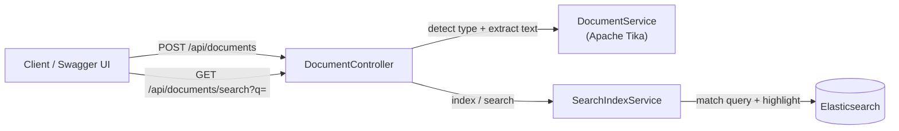

# Document Heartbeat 🫀

> **"Listening to what your files have to say."**

[](https://github.com/may-leth/doc-heartbeat/actions/workflows/ci.yml)
[](https://github.com/may-leth/doc-heartbeat/commits/dev)
[](https://www.conventionalcommits.org)


Upload any document (PDF, Word, EPUB, plain text…) and search inside its content in seconds, with the matching fragments highlighted.

## Table of contents

1. [About the project](#about-the-project)
2. [See it in action](#see-it-in-action)
3. [Architecture](#architecture)
4. [Tech stack](#tech-stack)
5. [Getting started](#getting-started)
6. [API endpoints](#api-endpoints)
7. [Testing strategy](#testing-strategy)
8. [Technical decisions](#technical-decisions)
9. [Roadmap](#roadmap)
10. [Author](#author)

## About the project

Most of the information we store lives inside files that nobody can search: contracts, reports, e-books. **Document Heartbeat** is the ingestion and search layer that turns those binary files into searchable text.

It detects each file's real type with **Apache Tika**, extracts its plain text, indexes it in **Elasticsearch**, and exposes a REST API to run full-text searches ranked by relevance.

## See it in action

Searching for `confidencialidad` across a PDF contract and an EPUB novel:

```bash
curl "http://localhost:8080/api/documents/search?q=confidencialidad"
```

```json
[
  {
    "fileName": "Acuerdo de Confidencialidad y Cesión de Imágenes.pdf",
    "mimeType": "application/pdf",
    "highlightedSnippet": "Acuerdo de <mark>Confidencialidad</mark> y Cesión de Imágenes. ... El Participante se compromete a mantener la <mark>confidencialidad</mark> de toda la información ...",
    "score": 0.37270126
  },
  {
    "fileName": "Poeta_chileno_Alejandro_Zambra.epub",
    "mimeType": "application/epub+zip",
    "highlightedSnippet": "... previo compromiso de <mark>confidencialidad</mark> ...",
    "score": 0.20007408
  }
]
```

* **Relevance ranking:** the contract, where the word is the main topic, scores higher than the novel, where it appears in passing.
* **Format-agnostic:** a PDF and an EPUB are searched the same way.
* **Highlighting:** `<mark>` tags let any frontend paint the matches without extra work.

## Architecture



| Layer | Responsibility |
|---|---|
| `controller` | HTTP boundary: receives files and queries, validates input |
| `service` | Text extraction (Tika) and indexing/search (Elasticsearch) |
| `mapper` / `dto` | Immutable `record` DTOs, decoupling API responses from the index model |
| `exception` | Centralized error handling with a consistent `ErrorResponse` |
| `config` | Elasticsearch client configuration |

## Tech stack

| Area | Technology |
|---|---|
| Language | Java 21 (records, modern collections API) |
| Framework | Spring Boot 4 (Web MVC, Bean Validation) |
| Text extraction | Apache Tika 3.2.3 |
| Search engine | Elasticsearch 9 with the official Java client |
| API docs | springdoc-openapi (Swagger UI) |
| Testing | JUnit 5, Mockito, MockMvc |
| CI | GitHub Actions |

## Getting started

**Requirements:** Java 21 and Docker.

1. Start Elasticsearch:

   ```bash
   docker run -d --name elasticsearch -p 9200:9200 \
     -e "discovery.type=single-node" \
     -e "xpack.security.enabled=false" \
     docker.elastic.co/elasticsearch/elasticsearch:9.2.3
   ```

2. Run the application:

   ```bash
   ./mvnw spring-boot:run
   ```

   To use another port, set the `SERVER_PORT` environment variable (e.g. `SERVER_PORT=8081`).

3. Open the interactive API docs at `http://localhost:8080/swagger-ui.html`.

## API endpoints

| Method | Endpoint | Description | Responses |
|---|---|---|---|
| `POST` | `/api/documents` | Uploads a file, extracts its text and indexes it | `200` · `400` no file · `500` processing/indexing error |
| `GET` | `/api/documents/search?q={text}` | Full-text search with highlighted snippets | `200` (list may be empty) · `400` missing/blank query · `500` search error |

## Testing strategy

Every layer is tested in isolation, covering three kinds of scenarios:

* **Happy paths:** valid uploads and searches return the expected data.
* **Sad paths:** Tika parsing errors and Elasticsearch failures are translated into clean `500` responses.
* **Edge cases:** missing or blank queries (rejected with `400` *before* reaching Elasticsearch), empty files, searches with no results and queries with accents and special characters.

```bash
./mvnw verify
```

Tests run automatically on every push and pull request through **GitHub Actions**.

## Technical decisions

### Apache Tika thread-safety strategy
A shared singleton instance of `Tika` is used within the `DocumentService` instead of instantiating per-request:
* **Thread-safety:** the basic parsing operations in Tika are thread-safe by design.
* **Performance:** reusing the instance improves performance by approximately **7x** (~3.2s vs ~22.8s for 1000 sequential parses in a local benchmark).
* **Evidence:** a benchmark test (`TikaPerformanceTest`) is included in the test suite. Results vary slightly between runs due to JVM JIT warmup and GC timing, but the relative improvement remains consistent.

### Input validation at the boundary
Request validation (e.g. a blank search query) uses **Bean Validation** (`@NotBlank`) in the controller, while business logic stays in the services. Invalid requests are rejected with `400` before any call to Elasticsearch.

### Centralized error handling
A `@RestControllerAdvice` (`GlobalExceptionHandler`) keeps controllers free of try/catch blocks and returns a consistent `ErrorResponse` for both validation (`400`) and processing (`500`) errors.

### "No results" is not an error
A search with no matches returns `200` with an empty list instead of `404`: the request was valid and the search was performed successfully.

## Roadmap

- [x] **Phase 1:** Project setup & Tika integration.
- [x] **Phase 2:** REST API for file upload, DTO/Mapper layer, centralized exception handling and Swagger documentation.
- [x] **Phase 3:** Elasticsearch integration: indexing and full-text search with highlighting.
- [ ] **Phase 4:** Dockerization of the complete pipeline (App + Elasticsearch) with Docker Compose.
- [ ] **Phase 5:** Continuous delivery: publish the Docker image automatically from GitHub Actions.

## Author

**Mayleth** · Backend developer

[](https://github.com/may-leth)
[](https://www.linkedin.com/in/maylethcarrascal/)
