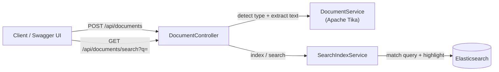

# Document Heartbeat 🫀

> **"Listening to what your files have to say."**

[](https://github.com/may-leth/doc-heartbeat/actions/workflows/ci.yml)
[](https://github.com/may-leth/doc-heartbeat/pkgs/container/doc-heartbeat)
[](https://github.com/may-leth/doc-heartbeat/commits/dev)
[](https://www.conventionalcommits.org)


Upload any document (PDF, Word, EPUB, plain text…) and search inside its content in seconds, with the matching fragments highlighted.

## Table of contents

1. [About the project](#about-the-project)
2. [See it in action](#see-it-in-action)
3. [Architecture](#architecture)
4. [Tech stack](#tech-stack)
5. [Getting started](#getting-started)
6. [API endpoints](#api-endpoints)
7. [Testing strategy](#testing-strategy)
8. [Technical decisions](#technical-decisions)
9. [Roadmap](#roadmap)
10. [Author](#author)

## About the project

Most of the information we store lives inside files that nobody can search: contracts, reports, e-books. **Document Heartbeat** is the ingestion and search layer that turns those binary files into searchable text.

It detects each file's real type with **Apache Tika**, extracts its plain text, indexes it in **Elasticsearch**, and exposes a REST API to run full-text searches ranked by relevance.

## See it in action

Searching for `confidencialidad` across a PDF contract and an EPUB novel:

```bash
curl "http://localhost:8080/api/documents/search?q=confidencialidad"
```

```json
[
  {
    "fileName": "Acuerdo de Confidencialidad y Cesión de Imágenes.pdf",
    "mimeType": "application/pdf",
    "highlightedSnippet": "Acuerdo de <mark>Confidencialidad</mark> y Cesión de Imágenes. ... El Participante se compromete a mantener la <mark>confidencialidad</mark> de toda la información ...",
    "score": 0.37270126
  },
  {
    "fileName": "Poeta_chileno_Alejandro_Zambra.epub",
    "mimeType": "application/epub+zip",
    "highlightedSnippet": "... previo compromiso de <mark>confidencialidad</mark> ...",
    "score": 0.20007408
  }
]
```

* **Relevance ranking:** the contract, where the word is the main topic, scores higher than the novel, where it appears in passing.
* **Format-agnostic:** a PDF and an EPUB are searched the same way.
* **Highlighting:** `<mark>` tags let any frontend paint the matches without extra work.

## Architecture



| Layer | Responsibility |
|---|---|
| `controller` | HTTP boundary: receives files and queries, validates input |
| `service` | Text extraction (Tika) and indexing/search (Elasticsearch) |
| `mapper` / `dto` | Immutable `record` DTOs, decoupling API responses from the index model |
| `exception` | Centralized error handling with a consistent `ErrorResponse` |
| `config` | Elasticsearch client configuration (address injected from the environment) |

At runtime, Docker Compose runs the application and Elasticsearch as two containers. The app only starts once Elasticsearch reports a healthy cluster, and indexed documents are stored in a persistent volume.


## Tech stack

| Area | Technology |
|---|---|
| Language | Java 21 (records, modern collections API) |
| Framework | Spring Boot 4 (Web MVC, Bean Validation) |
| Text extraction | Apache Tika 3.2.3 |
| Search engine | Elasticsearch 9 with the official Java client |
| API docs | springdoc-openapi (Swagger UI) |
| Testing | JUnit 5, Mockito, MockMvc, Testcontainers, JaCoCo |
| Containers | Docker (multi-stage build), Docker Compose |
| CI/CD | GitHub Actions: tests, coverage quality gate, Docker image build and publication to GitHub Container Registry |

## Getting started

### Run the published image (fastest)

Every change merged into `main` publishes a ready-to-run image to GitHub Container Registry. With Docker installed, no clone or build is needed:

```bash
docker network create doc-heartbeat

docker run -d --name elasticsearch --network doc-heartbeat \
  -e "discovery.type=single-node" -e "xpack.security.enabled=false" \
  -e "ES_JAVA_OPTS=-Xms512m -Xmx512m" \
  docker.elastic.co/elasticsearch/elasticsearch:9.2.3

docker run -d --name doc-heartbeat --network doc-heartbeat -p 8080:8080 \
  -e "ELASTICSEARCH_URI=http://elasticsearch:9200" \
  ghcr.io/may-leth/doc-heartbeat:latest
```

Wait a few seconds for Elasticsearch to start, then open `http://localhost:8080/swagger-ui.html`.

| Image tag | Content |
|---|---|
| `latest` | Latest stable version (`main`) |
| `1.0.0`, ... | A specific release |
| `dev` | Latest development version |
| `sha-<commit>` | The exact build of a given commit |

### Run everything with Docker Compose (from source)

**Requirements:** Docker only. No Java or Elasticsearch installation needed.

```bash
docker compose up --build
```

Then open the interactive API docs at `http://localhost:8080/swagger-ui.html`, upload a document and search it.

If port 8080 is busy, choose another one with the `APP_PORT` variable:

```bash
APP_PORT=8081 docker compose up --build
```

Stop with `docker compose down` (add `-v` to also delete the indexed documents).

### Run locally for development

**Requirements:** Java 21 and Docker.

1. Start only Elasticsearch: `docker compose up elasticsearch`
2. Run the application: `./mvnw spring-boot:run`

### Configuration

All settings can be overridden with environment variables, without changing the code:

| Variable | Default | Description |
|---|---|---|
| `ELASTICSEARCH_URI` | `http://localhost:9200` | Elasticsearch address used by the application |
| `SERVER_PORT` | `8080` | Port the application listens on |
| `APP_PORT` | `8080` | Host port exposed by Docker Compose |

## API endpoints

| Method | Endpoint | Description | Responses |
|---|---|---|---|
| `POST` | `/api/documents` | Uploads a file, extracts its text and indexes it | `200` · `400` no file · `500` processing/indexing error |
| `GET` | `/api/documents/search?q={text}` | Full-text search with highlighted snippets | `200` (list may be empty) · `400` missing/blank query · `500` search error |

## Testing strategy

The test suite combines two levels:

* **Unit tests** (JUnit 5, Mockito, MockMvc): each layer is tested in isolation, with fast feedback.
* **Integration tests** (Testcontainers): a real Elasticsearch node is started in Docker to verify what a mock cannot, such as the query, the highlighting and the relevance ranking.

Both levels cover three kinds of scenarios:

* **Happy paths:** valid uploads and searches return the expected data.
* **Sad paths:** Tika parsing errors, unreadable files and Elasticsearch failures are translated into clean `500` responses.
* **Edge cases:** missing or blank queries (rejected with `400` *before* reaching Elasticsearch), empty files, searches with no results, searches before any document is indexed, incomplete search hits and queries with accents and special characters.

**Coverage** is measured with JaCoCo and enforced as a quality gate: the build fails if line coverage drops below 90% or branch coverage below 85%.

```bash
./mvnw verify   # requires Docker running for the integration tests
```

On every pull request, **GitHub Actions** runs the full suite, checks coverage, comments the coverage report and builds the Docker image. Changes merged into `dev` or `main` are then published as Docker images.

## Technical decisions

### Apache Tika thread-safety strategy
A shared singleton instance of `Tika` is used within the `DocumentService` instead of instantiating per-request:
* **Thread-safety:** the basic parsing operations in Tika are thread-safe by design.
* **Performance:** reusing the instance improves performance by approximately **7x** (~3.2s vs ~22.8s for 1000 sequential parses in a local benchmark).
* **Evidence:** a benchmark test (`TikaPerformanceTest`) is included in the test suite. Results vary slightly between runs due to JVM JIT warmup and GC timing, but the relative improvement remains consistent.

### Input validation at the boundary
Request validation (e.g. a blank search query) uses **Bean Validation** (`@NotBlank`) in the controller, while business logic stays in the services. Invalid requests are rejected with `400` before any call to Elasticsearch.

### Centralized error handling
A `@RestControllerAdvice` (`GlobalExceptionHandler`) keeps controllers free of try/catch blocks and returns a consistent `ErrorResponse` for both validation (`400`) and processing (`500`) errors.

### "No results" is not an error
A search with no matches returns `200` with an empty list instead of `404`: the request was valid and the search was performed successfully. The same applies when nothing has been indexed yet: the missing index is treated as "no documents", not as a server error.

### Configuration from the environment
Following the [Twelve-Factor App](https://12factor.net/config) principle, the Elasticsearch address is read from configuration (`ELASTICSEARCH_URI`) instead of being hard-coded. The same build runs on a laptop, inside Docker Compose and in integration tests, each pointing to a different Elasticsearch.

### Lean and secure container image
The `Dockerfile` uses a **multi-stage build**: a JDK image compiles the application and only the resulting JAR is copied into a smaller JRE image. Dependencies are downloaded in a separate layer, so rebuilding after a code change reuses the cache. The application runs as a **non-root user**.

### Startup ordering with health checks
Docker Compose waits for Elasticsearch to report a `green` or `yellow` cluster status before starting the application, instead of only waiting for the container to start.

### Continuous delivery with traceable images
The CI/CD pipeline builds the Docker image on every pull request to validate it, but only **publishes** it once the change is merged or a version is tagged, and always after the tests pass. Each image is tagged with its commit SHA, so any running version can be traced back to the exact code it was built from. Authentication uses the short-lived `GITHUB_TOKEN`, with no stored credentials, and only the publishing job has write access to packages.

### Real dependencies in integration tests
Mocks verify that the code calls Elasticsearch, but not that the query is correct. Integration tests run against a real Elasticsearch node with **Testcontainers**, using the same version as production.

## Roadmap

- [x] **Phase 1:** Project setup & Tika integration.
- [x] **Phase 2:** REST API for file upload, DTO/Mapper layer, centralized exception handling and Swagger documentation.
- [x] **Phase 3:** Elasticsearch integration: indexing and full-text search with highlighting.
- [x] **Phase 4:** Dockerization (multi-stage image, Docker Compose with health checks) and integration tests with Testcontainers.
- [x] **Phase 5:** Continuous delivery: Docker images published automatically to GitHub Container Registry.

## Author

**Mayleth** · Backend developer

[](https://github.com/may-leth)
[](https://www.linkedin.com/in/maylethcarrascal/)
